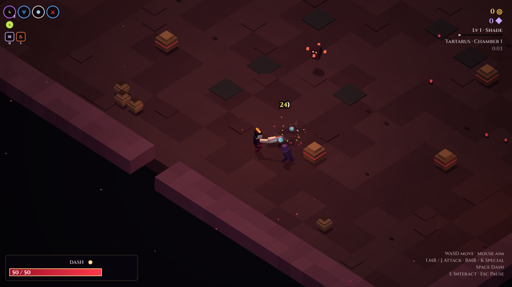
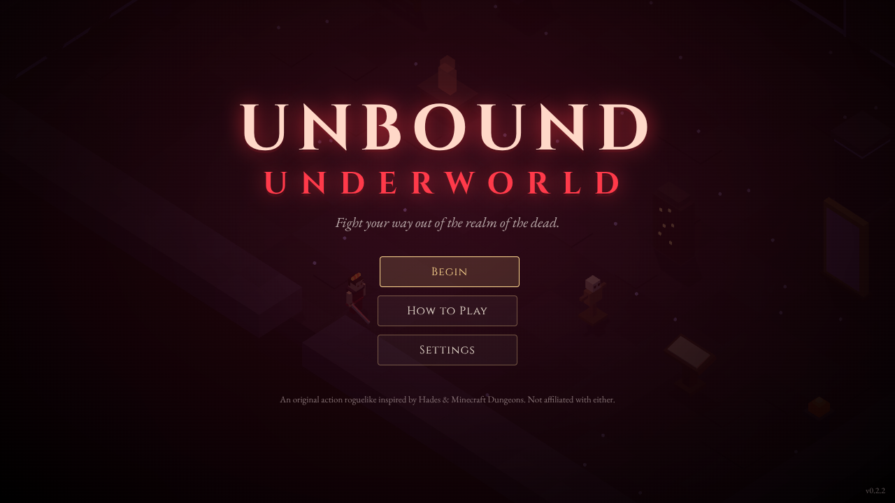
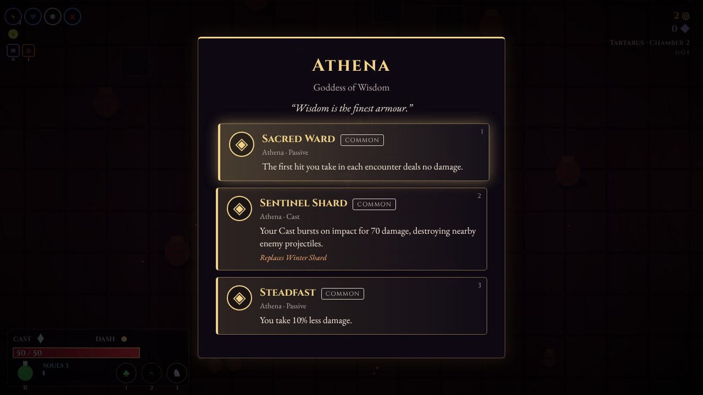
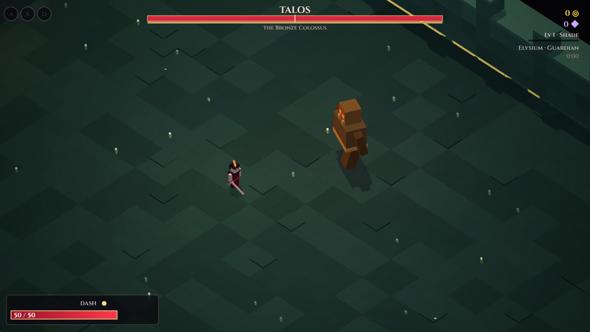

# Unbound Underworld

A fast, top-down action roguelike for desktop, phones and the browser. You fight your way out of the realm of the dead, one chamber at a time. The core loop is modeled on **Hades**, and it adds systems inspired by **Minecraft Dungeons II**: jump attacks, cooldown artifacts, enchantments, loot chests and enchanted foes.



| | |
|---|---|
|  |  |
|  | |

## Download

Get the latest build from the [Releases page](https://github.com/MEZTKING/Unbound-Underworld/releases).

> For now, new releases include only the **Windows installer** and the **Android APK**. The portable Windows build, macOS, Linux and the web zip were last published in [v0.2.1](https://github.com/MEZTKING/Unbound-Underworld/releases/tag/v0.2.1). They can be built again at any time (see *App builds* below).


| Platform | File | How to run |
|---|---|---|
| Windows | `Unbound-Underworld-Setup-<version>.exe` | Run the installer. |
| Windows (no install) | `Unbound-Underworld-<version>-Portable.exe` | Double-click to play. |
| macOS (Intel & Apple silicon) | `Unbound-Underworld-<version>-mac-universal.dmg` | Open the disk image and drag the app to Applications. |
| Linux | `Unbound-Underworld-<version>-linux-x86_64.AppImage` | `chmod +x` the file, then run it. |
| Android | `Unbound-Underworld-<version>-android.apk` | Open the file on your phone and allow installing from this source when asked. |

The builds are **not code-signed** by a store, so your system will warn you the first time you open the game:

- **Windows:** in the SmartScreen prompt, choose *More info → Run anyway*.
- **macOS:** right-click the app and choose *Open*, then confirm. If it still refuses, run `xattr -cr "/Applications/Unbound Underworld.app"`.
- **Android:** allow "Install unknown apps" for your browser or file manager.

In the desktop app, press `F11` or `Alt+Enter` to toggle fullscreen. Your progress is saved on your device.

**Saving and quitting.** An escape in progress is saved automatically when you enter a chamber, and again the moment you win it (and after every boon, purchase or chest there). In the pause menu, *Save & Quit to Title* (or *Save & Exit Game* in the desktop and Android apps) lets you stop at any time. *Resume Escape* on the title screen picks up where that save left you, even if the app was closed: at the start of the chamber, or in the won chamber with its fight over, any reward you hadn't taken (or were still choosing) waiting for you, and the same doors to choose from. Party escapes aren't saved, so quitting one asks first.

### Updates

When a new version comes out, the title screen shows **Update now**. You can also check under *Settings → Check for updates*. Your progress carries over.

- **Windows (installer) and Linux:** one press downloads the update, and the game restarts on the new version.
- **Android (from 0.6.0):** one press downloads the update inside the game and opens Android's installer; tap *Update* there and you're done. The first time, Android asks you to allow installs from Unbound Underworld. (Versions before 0.6.0 open the download in the browser instead.)
- **Windows (portable) and macOS:** the button downloads the new version for you. Open the file to install it over the old one.
- **Web version:** the game picks up the new version on its own. If it's open while you update the site, it offers *Restart to update*.

### iPhone and iPad (the web version)

iPhones only install apps from the App Store, so on iOS you play the web version instead. Each release includes `Unbound-Underworld-<version>-web.zip`. Put it on a free static host once, and you get a link you can open on any phone or computer:

- **Cloudflare Pages** (free, recommended): sign up at [cloudflare.com](https://dash.cloudflare.com/sign-up), then go to *Workers & Pages → Create → Pages → Upload assets*. Name the project and drop in the zip. You get an address like `https://unbound-underworld.pages.dev`. To update it later, upload the newer zip to the same project.
- **Netlify Drop:** drag the unzipped folder onto [app.netlify.com/drop](https://app.netlify.com/drop). Create a free account when it asks, or the site is deleted after an hour.
- **itch.io:** create a project, set *Kind of project* to *HTML*, upload the zip and tick *This file will be played in the browser*. This is the easiest place to share the game with friends. The game runs inside the itch.io page, though, so it doesn't open fullscreen from the home screen like the options above.

Open your link in Safari and tap *Share → Add to Home Screen* (in Chrome on Android: *⋮ → Add to Home screen*). The game then opens fullscreen like an app, works offline and keeps its saves on the phone. Hold your phone sideways to play.

On touch screens, drag anywhere on the left half to move. The buttons on the right are **⚔** Attack (tap to chain, hold after a hit for a powered attack, drag to aim), **✦** Special, **◆** Cast, **»** Dash, **⤒** Jump and **⛨** Guard. The small buttons above them are your artifacts and **⚗** potion. Without a drag, attacks aim at the nearest foe.

## Game documentation

- **[docs/DESIGN.md](docs/DESIGN.md):** how the game works. Covers the run structure, progression and unlock order, combat, build systems, heroes, enemy and boss behaviour, where everything lives in the code, and how to add new content.
- **[docs/GAME_DATA.md](docs/GAME_DATA.md):** every number in the game, generated from the code. This includes the level table, the Altar of Ashes, hero skill trees, the Blacksmith, heroes, weapons and forge tiers, every boon, enchantment and artifact, regions, enemies, guardians and Torment. Run `npm run docs` after changing game data; CI checks that it's up to date.

## Play from source

```bash
npm install
npm run dev        # play in the browser at http://localhost:5173
npm run desktop    # or play in the desktop app window
```

To try the touch controls on a computer, open the browser's device toolbar (phone emulation) and reload.

`npm run build` writes a static site to `dist/`. It uses relative paths, so you can host it on any static server, in a subfolder too.

## Controls

| Action | Keyboard & mouse | Gamepad |
|---|---|---|
| Move / aim | `WASD` / mouse | Left stick / right stick |
| Attack (tap to chain; hold after a hit for the powered attack) | `LMB` or `J` | `X` |
| Special | `RMB` or `K` | `Y` |
| Cast a shard | `Q` or `L` | `RB` |
| Dash (brief invulnerability) | `Shift` | `A` |
| Jump (attack mid-air to **Slam**) | `Space` or `C` | `B` |
| Guard (hold to block, tap just before a hit to parry) | `F` | `LT` |
| Artifacts | `1` `2` `3` | `RT` · D-pad left · `L3` |
| Healing potion | `R` or `4` | `LB` |
| Wrath (ultimate, when the gauge is full) | `V` or `5` | `R3` |
| Interact | `E` | `Select` / `R3` |
| Switch 2D / 3D view | `Tab` | — |
| Turn the camera (3D, up to 45° each way) | `Z` / `X` | — |
| Pause · Mute | `Esc` · `M` | `Start` |

Menus work with the mouse, arrow keys with `Enter`/`Space`, or the D-pad with `A`/`B`. Number keys pick cards directly.

Every keyboard key can be changed under *Settings → Controls → Key bindings* (arrows, `Enter` and `Esc` always keep working in menus).

You can walk while you fight: basic attacks keep most of your speed and never push you forward, and only moves that are meant to (dash-strikes, some specials) lunge.

**The combat grammar.** Every weapon works the same way: tap Attack to chain hits; hold Attack after a chain hit to charge its **powered attack** (let go on the flash for a *Perfect*, +25%); use your Special straight out of a chain for a faster, stronger **combo special**. Hits in a row without getting hurt build the **combo meter** (+1% damage per 10 hits, up to +10%).

**Seeing your reach.** When you attack, a faint dashed outline in front of the hero shows where your next hit will land (it follows the chain: a wider sweep for a finisher, a line for a thrust or a shot); it fades a couple of seconds after you stop attacking. While a powered attack or a draw charges, the outline shows its full reach and fills up, and a **charge meter** over the hero shows how far it has powered up, the chain level it carries (pips), the gold *Perfect* window and the damage multiplier a release would deal now. Turn both off with *Attack range outline* in Settings.

**Guard and parry** (level 2). Hold Guard to block hits from the front; blocking drains a guard meter, and an empty meter staggers you. Tap Guard just before a hit lands to **parry**: no damage, the foe staggers, shots fly back, and your next attack is a sure critical **riposte**. Ground shockwaves can't be guarded: jump or dash. Each class guards its own way (see Heroes).

New players start with just Attack, Special and Dash. The other controls unlock as you level up (see below), and the HUD, the touch buttons and the in-game control lists only show what you've unlocked.

## What's in it

### Progression
- **Levels and ranks.** Slain foes, cleared chambers, guardians and escapes earn experience that carries over between runs. There are 50 levels and eleven ranks, from Shade to Deathless. Every level gives every hero +1 max Health (and every fifth level +1% damage), and levels open new sections of the Altar of Ashes.
- **Gentle onboarding.** The first runs only have Attack, Special and Dash. New mechanics unlock one at a time, each announced with a short explanation: Guard & Parry, Healing Potion and Gear (level 2), Cast (3), Artifacts (4), Jump & Slam (5, or as soon as you slay the final guardian), Enchantments (6), Hephaestus' Anvil (7), a second artifact slot (8), Wrath (10) and a third artifact slot (12).
- **The Altar of Ashes** holds permanent strength for every hero, bought with Ash. It runs from the weakest upgrades at the top to the strongest at the bottom, in five sections (Embers, Cinders, Flames, Blaze, Inferno); each section opens once you reach its level *and* have spent enough Ash on the sections above, so the big ones (Death's Reprieve above all) come late and cost a lot. Completing it opens a second table, **the Deep Altar**, with fewer, far stronger and far dearer upgrades (gated up to level 48). Both tables together are paced to finish around level 50.
- **Hero skill trees.** Each hero has their own tree at *Ascension*, with three branches (offence, endurance and a signature style) of four rows each, ending in a capstone. Points come from playing that hero: the experience you earn as them raises their own hero level (up to 20, one point per level), and nothing is shared between heroes. There are more ranks than points, so every hero is built one way or another. Resetting a tree is free.
- **The Blacksmith** in the Hall stars up and salvages gear from the start, but his forge is in pieces. Each guardian guards one lost part, and each part he gets back lets him do more: the **Whetstone** (Vexa) lets him temper your hero's weapon with Ash, from Tier I up to Tier V (Mythic; from Tier III every fourth Attack unleashes an arcane wave); the **Ember Tongs** (the Many-Maw) reforge a piece's bonuses; the **Crucible** (Aurex) crafts plain and Rare gear of the slot you choose; the **Great Bellows** (Threefang) crafts Epic gear; and the **Anvil Heart** (any guardian under the Oath of Torment) crafts Legendary gear.
- **Heroes are classes.** Eight heroes, each with their own signature weapon, guard style, perks and **Wrath** ultimate. The *Hall of Heroes* shows the hero you play in one place (class, perks and Wrath, their weapon and its forge tier, the armour they wear and their skill tree), with a button to switch hero. From the start: *Kael* the Warrior (Nightblade sword, blade parry), *Lyra* the Ranger (Moonbow, evasive sidestep) and *Doran* the Vanguard (Thornspear and a tower shield). The rest unlock slowly, by level or by slaying guardians and escaping, whichever comes first: *Gorran* the Brawler (Titan Gauntlets, level 7 or your first guardian), *Ione* the Monk (Riptide Chains nunchaku, level 10 or 3 guardians), *Erebos* the Reaper (Reaper's Crescent, level 14 or 6 guardians), *Rook* the Gunner (Thunderbuss blunderbuss, level 18 or your first escape) and *Selene* the Duelist (Starsplitter katana, level 22 or 3 escapes). If a save's chosen hero is locked under these rules, it switches back to Kael. Ash spent unlocking weapons in earlier versions is refunded.
- **Wrath.** A golden gauge that fills as you deal and take damage. When it's full, press `V` to unleash your hero's screen-clearing ultimate.
- **Loot and gear.** From your very first escape, foes drop materials (Bone Dust, Ember Shards, Golden Ichor, Gate Pearls, Titan Scales), and foes, chests and guardians drop gear: helmets, armor, leggings and boots with random bonuses (health, damage, speed, critical chance, damage taken, dash recharge and more). Gear comes in seven tiers: Common, Uncommon, Rare, Epic, Legendary, Unique and the very rare Ghost. Common and Uncommon pieces are *plain*: they drop often, have no stars and can't be starred up (salvage them; *Salvage all plain pieces* clears them in one go). Rare and better pieces are *starred*: they drop with one star (each extra star half as likely, capped by your level) and are much rarer, about one or two in a run of 80 kills. Legendary pieces drop only from guardians, Unique ones from enchanted foes, guardians and Mimics, and a Ghost piece (0.1% from any foe) never rolls a weak bonus. Unique and Ghost pieces carry a perk of their own (an extra dash, Death Defiance, healing on kills…). Star a starred piece up to 5 gold stars, then on to 10, as the stars turn purple one by one. Drops fly to you when you walk near them (and all of them when a chamber is cleared), a feed on the left lists what you picked up, and the end of each escape shows your **Spoils**. Each tier has its own colour, and Legendary and Ghost pieces wear special frames (a gilded double frame with a gleam; a spectral frame that circles the piece). Equip gear in the Hall of Heroes or the pause menu (level 2); star it up, reforge, salvage and craft at the Blacksmith.
- **Save slots.** Four independent journeys; switch on the title screen.
- **Map.** The pause menu shows every region's chambers, where you are, the guardian ahead and your best run.

### The Hades-style core
- **Combat.** Each weapon has a chain, a powered attack, a dash-strike, a special and a slam. You get a cast shard that lodges in foes and has to be picked up again. The dash has invulnerability frames and a cooldown (0.9 s for each charge to come back) that only boons (Hermes' *Windstep*), the Altar, skills, gear and perks shorten; the DASH pips on the HUD refill like a clock. A dash leans the way it goes, so a backstep leans back. Hits have hit-stop, screen shake and knockback, and every enemy attack is telegraphed on the ground.
- **Eight weapons, one per class.** *Nightblade* (Crescent Cleave), *Moonbow* (quick shots, Power Shot, Rain of Arrows), *Thornspear* (Skewer Lance, a spin, a spear you throw and recall), *Titan Gauntlets* (Titan Uppercut, Meteor Fist), *Riptide Chains* (Whirlpool, Tidal Snap), *Reaper's Crescent* (Harvest, Soul Reap), *Thunderbuss* (Grapeshot Cannon, Powder Keg) and *Starsplitter* (Moonlit Iaido, Thousand Cuts). Each weapon has three or more anvil upgrades.
- **Foes that fight fair.** Foes turn at their own speed (circle a Brute to get behind it), lock their aim when a windup starts, take turns (only a few attack at once while the rest circle), come at you from different sides, and pause a moment after appearing. Higher Torment makes them more aggressive and more accurate.
- **Boons from eight Olympians plus Hermes.** Each god has Attack, Special, Cast and Dash boons, each with its own status effect: lightning, knockback and wall slams, deflection, Doom, Weak, critical hits, Hangover and Chill. Boons come in Common, Rare, Epic and Heroic rarity; the first boon of an escape is almost always Common, and higher rarities grow more likely region by region (every chance roll is listed in GAME_DATA.md → *Probabilities*). There are six duo boons, a limit of four gods per run, and Pomegranates that level boons up.
- **The run.** The Shackled Deep, then the Ember Fields, then the Gilded Groves, then the Last Gate: 20+ procedurally laid-out chambers. Each exit door shows its reward ahead of time (boon, Pomegranate, obols, Titan Heart, Ash, anvil, Hermes, enchantment, artifact, shop or fountain), with a short description: on PC point at the door's icon (or walk up to it); on phones it's on the floor in front of the door. Reward choices (and the pause menu) have a *Your build* page that lays out what you have: your Attack, Special, Cast and Dash boons side by side, your other boons grouped by god, then duos, anvil upgrades, enchantments and artifacts, and every one of them can be skipped for 25 obols. No two chambers are laid out alike: besides open halls they come as L, T and cross shapes, hourglasses with a narrow waist, rings round a rock island, recesses with the doors off to one side, long galleries and tall towers, and the doors and the way in move with the shape. Shops never block the way: walk through any door. Charon sells wares; what each one does is blurred until you've bought that kind once. An antechamber with a shop and a fountain comes before each guardian.
- **Four guardians.** *Vexa*, Warden of Chains. *The Many-Maw*, which grows extra heads. *Aurex, the Gilded Colossus*: break his armor and he overheats, leaving him open. *Threefang*, Hound of the Last Gate, who charges, breathes fire and leap-slams.
- **Meta-progression.** Ash carries over when you die. In the Hall of Shades hub you can spend it at the Altar of Ashes and the Blacksmith, unlock starting artifacts, pick your hero in the Hall of Heroes, raise their skill tree at Ascension, read your records, the **bestiary** (each foe stays a black silhouette until you slay it) and **achievements** in the Chronicle, customise your hero's colours and headwear (in the 3D view the preview is the voxel hero, seen from the game camera's angle; drag to turn it), raise the difficulty with *Torment* levels at the Oath of Torment, and practice on a training dummy.

### Inspired by Minecraft Dungeons II
- **Jump and Slam.** Hop over lava, chasms, spike traps and boss shockwaves. Attack mid-air for a weapon-specific ground slam.
- **Raised ground.** Harder chambers (later regions and higher Torment, once you can jump) have ledges: a dais before the exit doors, terraces across the room and mesas, some with a second tier. You jump up one level at a time and drop off the edge; foes clamber after you, and a reward on a ledge has to be fetched from up there.
- **Artifacts.** Three hotbar slots with 12 artifacts to find. Some run on cooldowns: Mending Totem, Thunder Rod, Gale Horn, Bone Whistle (summons a wolf), Ember Volley and others. Others spend **Echoes** left behind by fallen foes: Spirit Lantern, Echo Reaper, and the channeled Void Prism beam. The Echoes gauge starts every escape empty.
- **Healing potion** on a cooldown.
- **Enchantments.** A third build layer separate from the gods: 13 enchantments (Reverberation, Shackling, Combustion, Bloodthirst, Frenzy, Executioner, Singularity, Searing and more). Finding one again raises its tier, up to III.
- **Enchanted foes.** Swift, Armored, Volatile and Regenerating variants with a violet aura.
- **Treasure chests**, and very rarely (3%) a Mimic, which guards a Unique piece of gear.
- **New foes.** Hisslings (fused exploders), Weavers (web spitters that slow you) and Bonecallers (summoners).

### Campaign
**Campaign** on the title screen is a story mode alongside the escapes. **Chapter I, Chains of the Deep**, has six hand-made missions in the Shackled Deep: you wake in chains, follow Ysolde, a shade who remembers, through the cell blocks and up the Long Stair, and face Vexa, Warden of Chains. Each mission has a short story scene before and after, set chambers and foes, and its own goals (slay every foe, hold out until a gate turns, or defeat the guardian). Boons drop as you go; your hero, gear, skills and Altar come with you. Each mission earns up to three stars (finish it, beat its par time, lose no more than half your health) and Ash and experience, in full the first time. Missions open in order, aren't saved part-way, and never touch a saved escape. Chapter II is on the way.

### Multiplayer
Up to four heroes play together. Everyone keeps their own progress: experience, Ash, loot and kills go to each player's own save on their own device. Foes get tougher (+40% health) and more numerous (+35%) with each extra hero. A hero who falls is **downed**, not dead: stand beside them for a moment to revive them, and everyone gets back up when the chamber is cleared; the escape ends only when every hero is down. Rewards come to each player (on their own screen online, in turn on a shared screen), and when someone picks a door the party goes through it together two seconds later. Open *Multiplayer* from the title screen or the pause menu.

- **Local co-op (same screen).** *Multiplayer → Local co-op → Add a player*, then press any button on the new player's gamepad and pick their hero. Player 1 keeps the keyboard and mouse (or another gamepad). The camera keeps everyone in view, and player 2 gets their own HUD panel at the bottom right.
- **Same Wi-Fi or hotspot.** In the Windows or Android app, *Host on this network* hosts from your device (allow it through the Windows firewall if asked). Others choose *Find games nearby* and join with one click, or type the host's address (shown when you start hosting). A phone sharing its hotspot can host, too. The web version can join by address when it's opened over `http` (browsers only allow secure `wss://` connections from the `https` site).
- **Online, through your own server.** Run the server below on any machine with Node 18+, then everyone enters its address under *Online*: the host picks *Host here* and gets a 5-letter **room code**, and the others *Join* with it. Anyone can host this way, from Windows, Android or the browser. A player whose connection drops is reconnected into their seat automatically (the server keeps it for two minutes, and keeps the game for a minute if the host drops).
- **Cloud saves with Google Drive.** *Save Slot → Sync between devices* (or *Multiplayer → Sync saves between devices*) → *Sign in with Google* on each device, with the same Google account. Each save slot is kept in a hidden folder in your own Google Drive that only the game can see, so slot 1 on your phone and slot 1 on your PC share their progress. With *Keep in sync* on (the default), the save uploads after each escape. When the game starts, it offers the Drive copy if that copy is newer. Builds offer this once the Google Cloud project is set up: see [docs/GOOGLE_DRIVE.md](docs/GOOGLE_DRIVE.md).
- **Sync saves through your server.** In the same screen: pick a sync key (or make one), *Upload this save* on one device and *Download to this device* on the other, through your server. Turn on *Keep in sync* to upload after each escape and be offered the newer save when the game starts. Without a server, *Copy save code* and paste it on the other device.

**Running the game server.** It's one folder with no packages to install: `server/` in this repository, also attached to every release as `Unbound-Underworld-Server-<version>.zip`.

```bash
node server/index.cjs                         # ws://<your address>:7777, saves kept in ./saves
node server/index.cjs --port 8080 --name "Friday night"
node server/index.cjs --cert cert.pem --key key.pem   # wss:// (needed by the https web version)
docker build -t unbound-underworld-server server && docker run -d -p 7777:7777 -v uu-saves:/data unbound-underworld-server
```

For play over the internet, forward the port on your router (or run it on a VPS); `node server/index.cjs --help` lists every option. Players on the same network can also use it with `--lan`, which lets *Find games nearby* see it. Everyone must run the same game version.

### Settings
*Settings* (on the title screen or in the pause menu) has:
- **Audio:** sound and music volume, mute.
- **Gameplay:** Assist mode (take half damage), aim assist, damage numbers, the attack range outline and charge meter, control hints, and (on phones) door descriptions for every door or only the one you walk up to.
- **Display:** the **3D voxel view** (on by default, with a Hades-style angled camera) or the classic 2D view, plus **UI size**, a **window mode** on desktop (Windowed, Borderless or Fullscreen), screen shake, flash intensity, hit-stop, an FPS counter and fullscreen. On desktop the 3D view has real-time shadows and lights. Phones get a lighter version without shadows, at a lower resolution. If a device can't run WebGL, the game uses the 2D view.
- **Touch:** button size and opacity, a left-handed (mirrored) layout, and vibration.

On PC, point at a HUD icon (boons, enchantments, artifacts, potion) to see what it does. The synthesized score uses strings, flute, bells, a lyre, a choir and drums; each guardian has its own battle theme, which intensifies (and brings in the choir) in phase 2.

**Autosave.** The game saves at the start of every chamber (a small *Saved* mark appears at the top of the screen), whenever you pick up loot or change something in the hub, and whenever you switch away from it.

**Developer options.** A hidden test menu: tap the version number in Settings seven times (or add `?dev` to the address). It has god mode, play-at-level, +Ash, unlock everything, test chambers for every region and room type, and in-run tools (boons, artifacts, obols, Wrath, spawning foes and guardians). Using it switches achievements off until the game restarts.

## Development

```bash
npm test           # Vitest unit tests (combat pipeline, boons, rooms, run flow, saves)
npm run docs       # regenerate docs/GAME_DATA.md from the game data
npm run typecheck
npm run build
```

### App builds

The desktop app is the same game wrapped in [Electron](https://www.electronjs.org/) (`electron/main.cjs`), packaged with [electron-builder](https://www.electron.build/). The Android app wraps it with [Capacitor](https://capacitorjs.com/) (`android/`).

```bash
npm run dist:desktop            # installers for your current OS, written to release/
npm run dist:desktop -- --linux # or pick a platform: --win, --mac, --linux
npm run android:apk             # Android debug APK (needs the Android SDK and Java 21)
```

The **App builds** GitHub workflow builds the Windows installer and the Android APK. To also build the portable Windows exe, macOS, Linux and the web version zip, run it from the Actions tab with *all_platforms* ticked. Push a version tag and it publishes the builds on a GitHub Release:

```bash
npm version patch               # bump the version in package.json and create a tag such as v0.1.1
git push --follow-tags
```

Build artifacts are kept for only one day and aren't uploaded for pull requests. After a release is published, the release job deletes them, because the downloads live on the Release. The **Clean up artifacts** workflow runs weekly and can be started from the Actions tab: it removes leftovers to keep the account's Actions storage low.

You can also release without the command line: open *Actions → App builds → Run workflow* and enter the version from `package.json` (for example `0.1.1`). The workflow builds everything, creates the `v0.1.1` tag and publishes the Release. If you leave the version empty, the installers are only attached to the run as downloadable artifacts.

**Android signing (needed for updates and Google Play).** Without extra setup, the APK is signed with a throwaway debug key. Each build gets a different key, so Android refuses to install a newer version over the old one ("App not installed"), and the old one has to be uninstalled first, which loses its saves. Set this up before you share the APK, so every build is signed with the same key. Create a key once:

```bash
keytool -genkeypair -v -keystore unbound.keystore -alias unbound -keyalg RSA -keysize 2048 -validity 10000
base64 -w0 unbound.keystore   # on macOS: base64 -i unbound.keystore
```

Then add these repository secrets (*Settings → Secrets and variables → Actions*): `ANDROID_KEYSTORE_BASE64` (the base64 output), `ANDROID_KEYSTORE_PASSWORD`, `ANDROID_KEY_ALIAS` (`unbound`) and `ANDROID_KEY_PASSWORD`. Keep the keystore file and passwords somewhere safe and private: you need the same key for every future update, and anyone who has it can sign apps as you.

**Google Play.** Once the signing secrets are set, each **App builds** run also makes `Unbound-Underworld-<version>-play.aab`. Download it from the run's *Artifacts* section; it isn't attached to the public release. That build has no in-game update button, because Google Play installs updates itself. To publish:

1. Create a [Google Play Console](https://play.google.com/console) developer account (a one-time fee of US$25).
2. Create the app, fill in the store listing, content rating and data safety forms, and link a privacy policy. The game collects no data: saves stay on the device.
3. Upload the `.aab` to a release track. Google keeps the final app-signing key (Play App Signing); your key becomes the *upload key*.
4. For each new version, bump the version in `package.json`, run the workflow and upload the new `.aab`. Play then updates players' games automatically.

New personal developer accounts must run a closed test with at least 12 testers for 14 days before the app can go public.

### Debug parameters

These URL parameters are handy for testing:

| Param | Effect |
|---|---|
| `?god` | Take no damage |
| `?biome=0..3` | Start runs in a later region |
| `?room=boss` | Start a run in that region's guardian chamber |
| `?weapon=sword\|spear\|bow\|fists\|scythe` | Try a weapon for this session |
| `?level=12` | Play at that level for this session (unlocks everything up to it) |
| `?seed=123` | Use a fixed run seed |
| `?dev` | Show the developer options |
| `?view=2d` | Use the classic 2D view for this session |
| `?quality=high\|balanced` | Force the 3D view's quality (shadows on or off) |

### Project layout

```
electron/        desktop app shell (window, app:// file serving, fullscreen toggle, self-updating, LAN hosting, Google sign-in)
android/         Android app project (Capacitor): landscape, immersive fullscreen, icons, LAN hosting plugin (LanRelay)
server/          the multiplayer relay: relay-core.cjs (rooms, codes, rejoining, save sync; a dependency-free WebSocket server),
                 lan.cjs (finding games nearby), index.cjs (the standalone server), Dockerfile
pwa/             service worker template for the installable web version
public/          web manifest and home-screen icons
build/           app icon used for the installers
src/
  updates.ts     update checks against the latest GitHub release, and the one-button update
  engine/        math & RNG, collision, input (keyboard/mouse/gamepad), synth audio, camera, particles
  game/
    game.ts      orchestrator: hub, run flow, rewards, shop, saves (implements WorldHost)
    world.ts     one room's simulation: actors, hitboxes, projectiles, zones, traps, doors, flow-field AI
    player.ts    movement, dash, jump/slam, cast, potion, action state machine
    weapons.ts   sword, spear, bow (and shared weapon helpers)
    boons.ts     gods, boons, duos, rarities, offers, stat computation
    progression.ts  levels, rank tiers, feature unlocks, level bonuses, weapon forge
    altar.ts     the Altar of Ashes: two tables of sectioned permanent upgrades
    herotree.ts  each hero's skill tree and hero levels
    smith.ts     the Blacksmith's forge parts
    party.ts     party members (local co-op and online)
    characters.ts   heroes, their perks and Wrath ultimates
    arsenal.ts   late-game weapons (Titan Gauntlets, Reaper's Crescent)
    prefs.ts     live gameplay/display settings
    enchants.ts  enchantments    artifacts.ts  artifacts & allies
    combat.ts    damage pipeline and status effects
    enemies/     enemy base class, regular foes, bosses
    rooms.ts     biomes, procedural layouts, encounters
    run.ts       per-run state and door rewards
    meta.ts      save data, slots and migrations
    render.ts    2D room art, lighting, effects, and the overlay drawn over the 3D view     hud.ts  HUD
  render3d/
    voxel.ts     the 3D voxel view (three.js): block rooms, props, doors and animated figures
  net/           online play: relay link, host (snapshots, effects, remote controls), client (mirror world, prediction),
                 state sync, LAN bridges, save sync, Google Drive cloud saves
  ui/            DOM menus (boon cards, Altar, Ascension, Hall of Heroes, Blacksmith, multiplayer, pause…) and touch controls
tests/           Vitest suites
scripts/         gen-docs.ts (writes docs/GAME_DATA.md)
docs/            DESIGN.md (how the game works), GAME_DATA.md (generated reference), GOOGLE_DRIVE.md (cloud save setup), screenshots
```

The art is all made in code: the 3D view builds every room, prop and character from blocks with three.js, and the 2D view draws them on a canvas. Every sound and the music are synthesized with WebAudio, so the game ships without any image or audio files. The fonts (Cinzel and EB Garamond, under the SIL Open Font License) are bundled, so the game also runs offline. Progress is saved to `localStorage`.

## Credits

This is an original fan project, inspired by *Hades* (Supergiant Games) and *Minecraft Dungeons* (Mojang Studios / Microsoft). It has no affiliation with either, and it uses none of their assets, characters or names. The gods, monsters and places come from Greek mythology.
